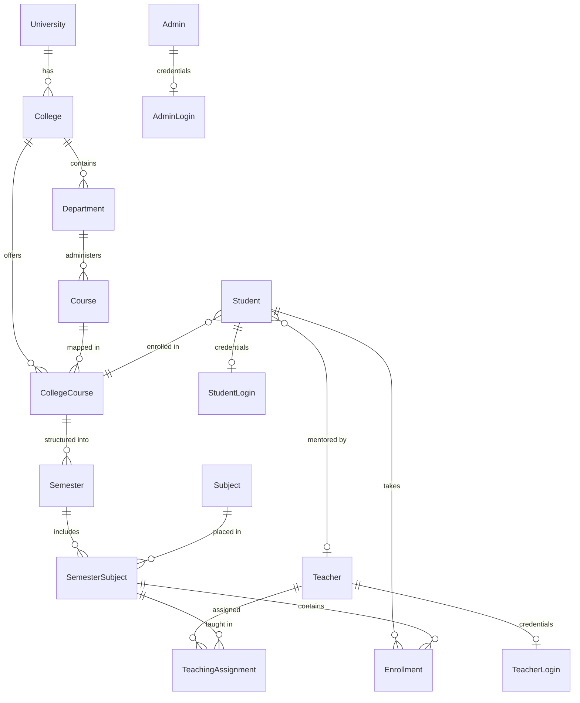

# CampusDesk — Complete Project Architecture & Documentation

## Executive Overview
**CampusDesk** (Student Management System) is a multi-tier academic management web application built on **Node.js, Express, MongoDB (Mongoose), and EJS**. It supports role-based access control (RBAC) across three distinct roles: **Administrators** (Super Admin & College Admin), **Teachers**, and **Students**, alongside a public **University & College Directory**.

---

## 1. Backend Scripts & Configuration

### Directory Layout & Script Roles

| File / Script | Category | Purpose & Description |
| :--- | :--- | :--- |
| `server.js` | Core Entry Point | Configures Express server, session storage (`express-session` with `sms.sid`), middleware pipelines, flash messages, static asset paths, view engines, and top-level route orchestration. Connects to MongoDB on start and binds to `0.0.0.0:8000`. |
| `config/db.js` | Database Config | Handles Mongoose connection pooling via `process.env.MONGO_URI` with fallback to `mongodb://127.0.0.1:27017/student_management`. |
| `middleware/auth.js` | Security / RBAC | Enforces authentication and authorization barriers: `requireAuth`, `requireAdmin`, `requireSuperAdmin`, `requireTeacher`, and `requireStudent`. Handles automated redirection to login for unauthenticated requests. |
| `middleware/flash.js` | View State Middleware | Pulls one-time session flash notifications and binds `currentUser` and `flash` directly to `res.locals` for seamless EJS rendering. |
| `scripts/seed.js` | Data Population | Idempotent database seeder. Populates 10 verified Indian universities (Delhi, BHU, JNU, Jamia, AMU, Mumbai, Calcutta, Allahabad, IGNOU, Hyderabad), sample departments, courses, semester subjects, default admin accounts, and demo teachers/students. |
| `scripts/reset-admin-password.js` | Maintenance Utility | Explicit script to update the password hash of the configured administrative account (`ADMIN_EMAIL`) using bcrypt (`rounds: 10`). |

### NPM Scripts

- `npm run dev`: Runs the application in development mode with live reloading via `nodemon server.js`.
- `npm start`: Starts production Node server (`node server.js`).
- `npm run db:seed`: Executes `scripts/seed.js` to seed or update default records idempotently.
- `npm run admin:reset-password`: Resets the admin password directly using environment variable credentials.

---

## 2. Frontend Routes & Endpoints

CampusDesk utilizes server-side rendered (SSR) EJS views with session authentication, coupled with selective REST API endpoints for dynamic frontend dropdown population.

### Public & Authentication Routes (`routes/auth.js` & `server.js`)

| Method | Endpoint | Access | Functionality |
| :--- | :--- | :--- | :--- |
| `GET` | `/` | Public | Root redirector: sends logged-in users to `/admin`, `/teacher`, or `/student` dashboard; unauthenticated users to `home.ejs`. |
| `GET` | `/health` | Public | Returns JSON health state (`{ status: "ok", database: "connected" }`). |
| `GET` | `/login` | Public | Renders combined login interface for students and teachers. |
| `POST` | `/login` | Public | Authenticates student or teacher via email & bcrypt password check; establishes session. |
| `GET` | `/admin/login` | Public | Dedicated administrator sign-in page. |
| `POST` | `/admin/login` | Public | Validates admin credentials against `AdminLogin` collection. |
| `GET` | `/signup` | Public | Multi-step self-registration with in-memory simulated OTP (5-minute expiry). |
| `POST` | `/signup` | Public | Validates student/teacher registration payload, confirms OTP, creates login credentials, and auto-logs in. |
| `POST` | `/logout` | Authenticated | Destroys current session and redirects to `/`. |

### University Directory Routes (`routes/colleges.js`)

| Method | Endpoint | Access | Functionality |
| :--- | :--- | :--- | :--- |
| `GET` | `/colleges` | Public | Browsable college/university directory with search, state filtering, and pagination. |
| `GET` | `/colleges/:slug` | Public | University detail page displaying verified departments, academic programs, and source citations. |

### Administrator Routes (`routes/admin.js`)

Requires `requireAuth` + `requireAdmin`. Certain sub-routes require `requireSuperAdmin`.

| Method | Endpoint | Scope | Functionality |
| :--- | :--- | :--- | :--- |
| `GET` | `/admin` | Admin | Main dashboard showing key statistics (student, teacher, college counts) and audit logs. |
| `GET` / `POST` | `/admin/students` | Admin | List active students / Create new student with initial enrollment details. |
| `GET` | `/admin/students/new` | Admin | Form to register a new student. |
| `GET` / `POST` | `/admin/students/:id/update` | Admin | View/edit student record and academic status. |
| `POST` | `/admin/students/:id/archive` | Admin | Soft-deletes (archives) a student and disables their login account. |
| `GET` / `POST` | `/admin/teachers` | Admin | List teachers / Create new faculty profile and login credentials. |
| `GET` | `/admin/teachers/new` | Admin | Form to add faculty. |
| `GET` / `POST` | `/admin/teachers/:id/update` | Admin | View/edit faculty profile, department assignment, and skills. |
| `POST` | `/admin/teachers/:id/archive` | Admin | Soft-deletes a teacher and revokes login access. |
| `GET` / `POST` | `/admin/colleges` | Admin | View affiliated colleges / Register new college under an existing university. |
| `POST` | `/admin/colleges/:id/update` | Admin | Edit college details. |
| `POST` | `/admin/colleges/:id/archive` | Admin | Soft-deletes college record. |
| `GET` / `POST` | `/admin/departments` | Admin | Manage departments associated with colleges. |
| `POST` | `/admin/departments/:id/update`| Admin | Update department information. |
| `POST` | `/admin/departments/:id/archive`| Admin | Soft-deletes department record. |
| `GET` / `POST` | `/admin/courses` | Admin | Manage academic courses (degree programs, durations, fees). |
| `POST` | `/admin/courses/:id/update` | Admin | Update course metadata. |
| `POST` | `/admin/courses/:id/archive` | Admin | Soft-deletes course. |
| `GET` / `POST` | `/admin/subjects` | Admin | Manage subjects, credit values, and subject types (Credit vs Non-Credit). |
| `GET` | `/admin/academic-structure` | Admin | Interface for mapping Courses ➔ Semesters ➔ Subjects. |
| `POST` | `/admin/academic-structure/*` | Admin | Creates links for College-Courses, Semesters, and Semester-Subjects. |
| `GET` / `POST` | `/admin/assignments` | Admin | View and allocate teachers to semester subjects. |
| `POST` | `/admin/assignments/:id/status`| Admin | Approve or reject faculty teaching assignments. |
| `GET` | `/admin/reports` | Admin | Institutional data summaries, audit logs, and exportable reports. |
| `GET` / `POST` | `/admin/admins` | Super Admin | Manage administrative accounts and role assignments (`SUPER_ADMIN` vs `COLLEGE_ADMIN`). |

### Dynamic Admin API (`routes/admin-api.js`)

| Method | Endpoint | Purpose |
| :--- | :--- | :--- |
| `GET` | `/admin/api/colleges/:id/departments` | JSON API: Dynamic department lookup for selected college. |
| `GET` | `/admin/api/colleges/:id/courses` | JSON API: Dynamic course list for selected college. |
| `GET` | `/admin/api/courses/:id/semesters` | JSON API: Semester list for selected college-course link. |
| `GET` | `/admin/api/semesters/:id/subjects` | JSON API: Subject list for selected semester. |

### Student Portal (`routes/student.js`)

Requires `requireAuth` + `requireStudent`.

| Method | Endpoint | Functionality |
| :--- | :--- | :--- |
| `GET` | `/student` | Student personal dashboard showing enrolled course, active semester, registered subjects, and assigned mentors/teachers. |
| `POST` | `/student/profile` | Updates personal profile details (phone, avatar URL). |

### Teacher Portal (`routes/teacher.js`)

Requires `requireAuth` + `requireTeacher`.

| Method | Endpoint | Functionality |
| :--- | :--- | :--- |
| `GET` | `/teacher` | Teacher dashboard showing approved subject teaching assignments, assigned student cohorts, and department details. |
| `POST` | `/teacher/profile` | Updates faculty profile, bio, and technical skills. |

---

## 3. Database Schema (Mongoose Models)

All 18 schemas are centrally declared in `models/index.js` using Mongoose:

### Data Dictionary & Model Specifications

#### 1. `University`
- **Fields**: `name` (String, unique), `slug` (String, unique), `officialWebsite`, `city`, `state`, `description`, `publicPhone`, `publicEmail`, `logoUrl`, `campusImageUrl`, `sources` (Array of Strings), `departments` (`[{ name, sourceUrl }]`), `programs` (`[{ name, sourceUrl }]`).
- **Purpose**: Stores verified public university directory data.

#### 2. `College`
- **Fields**: `universityId` (Ref: `University`), `name`, `city`, `state`, `website`, `phone`, `email`, `archivedAt` (Date).
- **Index**: Compound unique on `{ universityId: 1, name: 1 }`.

#### 3. `Department`
- **Fields**: `collegeId` (Ref: `College`), `name`, `description`, `archivedAt` (Date).
- **Index**: Compound unique on `{ collegeId: 1, name: 1 }`.

#### 4. `Course`
- **Fields**: `name` (String, unique), `code` (String, uppercase), `durationYears` (Number), `totalFee` (Number), `description`, `departmentId` (Ref: `Department`), `archivedAt` (Date).

#### 5. `CollegeCourse`
- **Fields**: `collegeId` (Ref: `College`), `courseId` (Ref: `Course`).
- **Index**: Compound unique on `{ collegeId: 1, courseId: 1 }`.

#### 6. `Semester`
- **Fields**: `collegeCourseId` (Ref: `CollegeCourse`), `semesterNo` (Number, min: 1).
- **Index**: Compound unique on `{ collegeCourseId: 1, semesterNo: 1 }`.

#### 7. `Subject`
- **Fields**: `code` (String, unique, uppercase), `name` (String), `credits` (Number), `subjectType` (Enum: `CREDIT`, `NON_CREDIT`).

#### 8. `SemesterSubject`
- **Fields**: `semesterId` (Ref: `Semester`), `subjectId` (Ref: `Subject`).
- **Index**: Compound unique on `{ semesterId: 1, subjectId: 1 }`.

#### 9. `Student` & `StudentLogin`
- **Student**: `name`, `email` (unique), `studentId` (unique), `phone` (unique sparse), `collegeCourseId` (Ref: `CollegeCourse`), `departmentId` (Ref: `Department`), `semesterNo`, `academicYear`, `enrollmentDate`, `profileImageUrl`, `teacherId` (Ref: `Teacher`), `status` (`ACTIVE`, `INACTIVE`, `SUSPENDED`), `archivedAt`.
- **StudentLogin**: `studentId` (Ref: `Student`, unique), `username` (unique), `passwordHash`, `status` (`ACTIVE`, `DISABLED`).

#### 10. `Teacher` & `TeacherLogin`
- **Teacher**: `name`, `email` (unique), `employeeId` (unique), `phone` (unique sparse), `departmentId` (Ref: `Department`), `designation`, `skills` ([String]), `status`, `archivedAt`.
- **TeacherLogin**: `teacherId` (Ref: `Teacher`, unique), `username` (unique), `passwordHash`, `status`.

#### 11. `Admin` & `AdminLogin`
- **Admin**: `name`, `email` (unique), `collegeId` (Ref: `College`), `role` (Enum: `SUPER_ADMIN`, `COLLEGE_ADMIN`), `status`.
- **AdminLogin**: `adminId` (Ref: `Admin`, unique), `username` (unique), `passwordHash`, `status`.

#### 12. Relationships & Tracking
- **`TeacherSubjectSkill`**: Maps `teacherId` + `subjectId` + `skillName` with unique compound index.
- **`Enrollment`**: Maps `studentId` + `semesterSubjectId` with `enrollmentStatus` (`ENROLLED`, `COMPLETED`, `DROPPED`).
- **`TeachingAssignment`**: Maps `teacherId` + `semesterSubjectId` with `approvedByAdminId` and `status` (`PENDING`, `APPROVED`, `REJECTED`).
- **`LoginActivity`**: Logs login attempts: `role` (`STUDENT`, `TEACHER`, `ADMIN`), `accountId`, `username`, `success` (Boolean), `ipAddress`.
- **`ManagementActivity`**: Administrative audit trail: `actorId` (Ref: `Admin`), `action`, `entityType`, `entityId`, `entityLabel`, `collegeId`.

---

## 4. Architectural Highlights & Design Decisions
1. **Separation of Profile and Auth Credentials**: User profiles (`Student`, `Teacher`, `Admin`) are decoupled from authentication documents (`StudentLogin`, `TeacherLogin`, `AdminLogin`), preserving data isolation and allowing easy soft-deletion/disabling without data loss.
2. **Soft Deletions**: Academic entities implement `archivedAt: Date` rather than hard database removals, preserving relational integrity across historical academic records.
3. **Session-based SSR**: Employs server-side rendering with EJS and express-session cookies (`sms.sid`) with httpOnly and sameSite policies.
